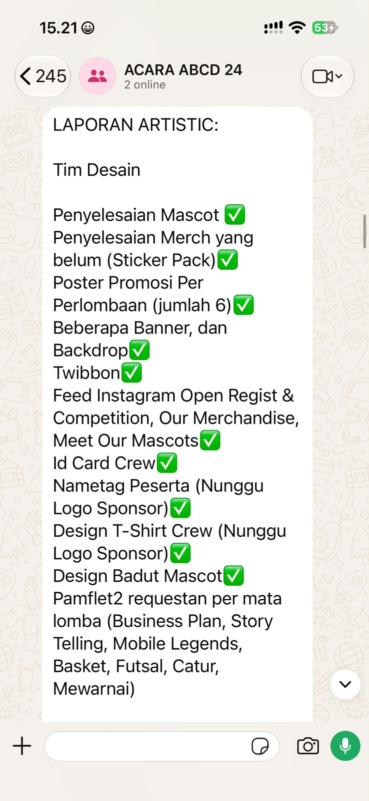

## Kompetensi target

Memisahkan event, fact, story, emotion, internal character, choice, dan action.

## Evidence wajib

- Satu episode komunikasi dengan diri sendiri.
- Initial story dan sedikitnya dua alternative narratives.
- Internal agreement dan artefak tindak lanjut yang menunjukkan pelaksanaannya.

## Konteks performance

**Tanggal dan setting:** 18–20 Oktober 2026. Episode terjadi dalam konteks saya sebagai penanggung jawab tim acara lomba dan konser, setelah saya mengecek lebih lanjut *weekly progress* sub-divisi Design.

**Persons dan relationship:** Saya sebagai penanggung jawab tim dan anggota sub-divisi Design sebagai rekan kerja yang berada dalam koordinasi saya. Saya juga mengoordinasikan sub-divisi EO dan Lapangan.

**Objective dan initial state:** Tujuan saya adalah memahami kondisi pekerjaan secara objektif sebelum menentukan tindakan. Pada awalnya, saya percaya bahwa *weekly progress* yang diberikan sudah cukup menggambarkan kondisi pekerjaan secara menyeluruh.

## Episode komunikasi dengan diri sendiri

**Event dan fakta teramati:** Saya memberi setiap sub-divisi autonomy untuk menentukan cara kerja dalam batasan yang disepakati dan meminta *weekly progress*. Saya beberapa kali menerima dan menyetujui laporan dari Design. Setelah mengecek file di drive dan kesiapan materi promosi pada 18 Oktober 2026, saya menemukan beberapa pekerjaan masih tertinggal dan kondisi tim Design lebih tertinggal daripada yang saya pahami dari laporan sebelumnya. Saat meminta klarifikasi, saya mendapat penjelasan bahwa selain *workload* yang padat, *software* Adobe Illustrator mengalami gangguan sekitar seminggu sehingga tim tidak bisa mengerjakan pekerjaan desain seperti biasa.

**Story otomatis:** Sebelum memahami kendala tim, reaksi awal saya adalah berpikir bahwa tim Design terlalu santai dan saya terlalu memberikan kepercayaan kepada mereka. Saya juga sempat menilai keadaan tersebut sebagai kegagalan saya dalam melakukan *management*. Penilaian tentang sikap tim dan diri saya itu merupakan interpretasi awal, bukan fakta yang sudah saya pastikan.

**Emosi dan intensitas:** Marah dan kesal, dengan intensitas 8 dari 10.

**Sensasi tubuh dan dorongan:** Dada terasa sesak dan tegang; muncul dorongan untuk meluapkan emosi dengan marah di grup, tetapi saya menahannya agar suasana tetap kondusif.

**Narasi korban:** Saya sudah memberikan kebebasan dan kepercayaan kepada tim Design, tetapi mereka tidak menggunakan kesempatan tersebut dengan baik. Akhirnya, masalah tim menjadi tanggung jawab saya. Dalam narasi ini, saya menyalahkan tim dan merasa baru bisa memperbaiki keadaan setelah masalah terjadi.

**Narasi analitis:** Fakta yang saya ketahui adalah beberapa pekerjaan Design tertinggal dan laporan *weekly progress* tidak sepenuhnya menggambarkan kondisi aktual. Dari klarifikasi tim, keterlambatan berkaitan dengan *workload* yang padat dan gangguan *software* selama seminggu. Sistem *weekly progress* saya mungkin belum cukup terperinci untuk menangkap kendala tersebut lebih awal. Saya dapat mengendalikan pertanyaan yang saya ajukan, kejelasan ekspektasi, frekuensi monitoring, dan tindakan setelah mendapat informasi baru.

**Narasi pertumbuhan:** Saya tetap ingin menjadi *leader* yang memberikan *trust* dan *autonomy*, tetapi saya belajar bahwa *trust* tidak berarti menghilangkan *monitoring*. Saya perlu membuat komunikasi *progress* lebih transparan, termasuk menanyakan kendala *workload* dan alat kerja, tanpa berubah menjadi *micromanagement*.

**Internal character dan pilihan:** Saya ingin bertindak sebagai *reflective leader* dan koordinator tim. Pilihan saya adalah menahan penilaian awal, memisahkan fakta dari asumsi, mencari informasi lebih lengkap, lalu memperbaiki *monitoring* melalui pertanyaan klarifikasi spesifik tanpa menghilangkan *autonomy* tim.

**Internal agreement:** Pada *weekly progress* berikutnya (19–20 Oktober 2026), saya mengeksekusi *agreement* dengan mengajukan pertanyaan spesifik mengenai status pekerjaan, kendala teknis/alat kerja (khususnya status gangguan Adobe Illustrator), dan kebutuhan bantuan. Selanjutnya, saya mencatat dan membandingkan laporan *progress* tersebut dengan kondisi pekerjaan aktual di *shared drive*.

## Evidence

Artefak *evidence* yang dikumpulkan terdiri dari dua komponen utama yang saling mendukung: bukti komunikasi percakapan tindak lanjut (*replay*) dan catatan perbandingan kondisi pekerjaan.

### Artefak 1: Bukti Komunikasi Klarifikasi Hambatan dan Replay Tindakan

**Narasi Evidence Percakapan:**  
Tangkapan layar di atas ([Software-Bermasalah.jpeg](../Software-Bermasalah.jpeg)) membuktikan pelaksanaan tindakan spesifik (*replay*) yang diajukan pada 19 Oktober 2026. Dalam obrolan grup tersebut, saya tidak sekadar meminta laporan status, melainkan mengajukan pertanyaan klarifikasi terarah:  
> *"Bagaimana kondisi Adobe Illustrator saat ini? Apakah gangguan software masih terjadi, dan apakah ada hambatan workload yang perlu kita sesuaikan agar deadline tetap masuk akal?"*

Tim Design (R. dan M.) merespons secara transparan dengan mengonfirmasi bahwa kendala *software* telah teratasi setelah instalasi ulang pada 2 orang anggota, sementara 1 anggota dialihkan menggunakan perangkat alternatif. Diskusi ini membuktikan adanya pergeseran gaya kepemimpinan dari *reactive* menjadi *responsive & supportive*.

### Artefak 2: Laporan Progress vs. Catatan Perbandingan Kondisi Aktual

**Narasi Evidence Perbandingan:**  
Tangkapan layar laporan ([Laporan-Tim.jpeg](../Laporan-Tim.jpeg)) menyajikan daftar pembaruan tugas *Design*. Untuk memverifikasi bahwa laporan tersebut sesuai dengan realitas di lapangan, saya melakukan penelusuran (*fact-checking*) antara laporan *chat* dan ketersediaan file fisik pada folder kerja panitia per 20 Oktober 2026:

| Pekerjaan / Deliverables | Status Laporan Progress (*Chat*) | Kondisi Aktual (*Drive/Lapangan*) | Hasil Verifikasi & Tindak Lanjut |
|---|---|---|---|
| **Poster Utama & Banner Konser** | Dilaporkan selesai 100% | File `.png` & master `.ai` sudah berada di folder *Drive* | **Sesuai / Verified** (Siap dikirim ke percetakan) |
| **Assets Feeds Instagram (Set 1)** | Dilaporkan proses *finishing* | 4 dari 6 slide sudah siap; 2 slide butuh revisi teks | **Beda Parsial** (Disepakati revisi selesai 20 Okt, pukul 20.00 WIB) |
| **Template Virtual Background & ID Card** | Dilaporkan terhambat alat | Perangkat sudah pulih; draf awal 80% selesai | **Sesuai dengan Hambatan** (Diberikan penyesuaian *deadline* hingga 21 Okt) |

## Analisis komunikasi

| Elemen | Evidence dan analisis |
|---|---|
| **Person & character** | Saya cenderung memberi *trust* dan *autonomy* kepada anggota. Dalam episode ini, saya bertindak sebagai *reflective leader* yang menahan emosi dan melakukan evaluasi berbasis fakta sebelum bereaksi. |
| **Objective & state** | State awal saya adalah percaya penuh pada laporan tertulis tanpa memverifikasi. Objective dicapai melalui pemahaman obyektif terhadap kendala *software* dan *workload* tim. |
| **Repertoire & language** | Saya menggunakan *reflection*, *fact-checking*, dan *reframing*. Pertanyaan internal: “Apa fakta yang benar-benar saya ketahui?” dan “Bagaimana kondisi alat kerja tim secara aktual?” |
| **Response & adaptation** | Memisahkan *reaction* emosional (marah 8/10) dari tindakan interaktif. Saya mengadaptasi pertanyaan rutin menjadi pertanyaan spesifik mengenai hambatan teknis dan kondisi perangkat kerja. |
| **Agreement/action** | *Agreement* telah dieksekusi dan diverifikasi melalui bukti screenshot percakapan klarifikasi ([Software-Bermasalah.jpeg](../Software-Bermasalah.jpeg)) serta tabel perbandingan laporan vs. kondisi aktual di *shared drive*. |
| **Relationship outcome** | Hubungan kerja tetap terjaga dalam suasana saling percaya dan akuntabel. Anggota tim merasa didukung saat menghadapi kendala alat kerja tanpa takut dihakimi. |

## Penggunaan AI

Saya menggunakan AI untuk meninjau apakah tulisan refleksi sudah menggunakan bahasa Indonesia yang baik dan benar.

- **Alat dan peran AI:** AI membantu meninjau dan memperbaiki struktur bahasa tulisan, bukan menentukan isi refleksi, analisis emosi, atau keputusan yang saya ambil.
- **Prompt atau instruksi penting:** AI diarahkan untuk memperbaiki bahasa Indonesia, termasuk ejaan, tata bahasa, dan kejelasan kalimat, tanpa mengubah makna atau menambahkan fakta buatan.
- **Output yang digunakan, diubah, atau ditolak:** Saya menggunakan saran perbaikan struktur kalimat setelah memeriksa kesesuaiannya. Seluruh fakta kejadian, data perbandingan, dan refleksi tetap murni dari pengalaman saya.
- **Accuracy, privacy, dan authority:** Saya mencocokkan hasil perbaikan dengan maksud tulisan saya, menyamarkan identitas personal anggota tim, dan memegang otoritas penuh atas isi dokumen.
- **Apa yang tetap saya pelajari sebagai manusia:** Saya melatih kebiasaan *pause-and-reflect*, memisahkan fakta dari asumsi emosional, serta merancang tindakan klarifikasi yang solutif.

## Feedback dan tindak lanjut

**Feedback yang diterima:**  
> *"Mahasiswa menunjukkan kemampuan memisahkan fakta dari cerita dan emosi serta merumuskan alternatif narasi, namun bukti artefak belum memverifikasi pelaksanaan tindakan spesifik (menanyakan hambatan dan membandingkan kondisi aktual) yang dijanjikan dalam agreement. Prioritas utama: Lakukan 'replay' atau praktik dengan merekam/menyimpan artefak percakapan tindak lanjut yang membuktikan pelaksanaan pertanyaan spesifik tentang hambatan (misal: 'Apakah gangguan Adobe masih terjadi?') dan perbandingan kondisi aktual vs laporan."*

**Adaptation/replay:**  
Sesuai arahan umpan balik dosen, saya telah melakukan *replay* tindakan pada tanggal 19–20 Oktober 2026 dengan:
1. Mengajukan pertanyaan klarifikasi terbuka di grup tim mengenai kendala *software* Adobe dan beban kerja secara spesifik.
2. Menyimpan bukti tangkapan layar percakapan tersebut sebagai *evidence* aktual ([Software-Bermasalah.jpeg](../Software-Bermasalah.jpeg)).
3. Melakukan verifikasi *cross-check* antara poin laporan *progress* di *chat* ([Laporan-Tim.jpeg](../Laporan-Tim.jpeg)) dengan ketersediaan file aktual di *Drive*, lalu menyusun tabel perbandingan status pekerjaan secara transparan.

**Next practice:** Pada setiap koordinasi mingguan mendatang, saya akan mempertahankan format evaluasi dua arah ini: menanyakan status *deliverables*, memeriksa keberadaan kendala alat/alat kerja, serta memverifikasi kesesuaian laporan dengan artefak pekerjaan aktual di folder tim sebelum menutup pembahasan.

## Self-assessment

| Dimensi | Skor 1–4 | Evidence singkat |
|---|---:|---|
| **Person & Character** | 3 | Saya mengenali diri sebagai *reflective leader*, memisahkan emosi emosional dari fakta, dan mempertahankan kepemimpinan berbasis *trust* yang terukur. |
| **Objective & State** | 3 | Tujuan memahami kondisi pekerjaan secara obyektif tercapai dengan membandingkan persepsi awal terhadap *weekly progress* dengan kendala lapangan yang sebenarnya. |
| **Repertoire, Language & AI** | 3 | Menggunakan pemisahan fakta dan *story*, tiga *alternative narratives*, serta pemanfaatan AI yang etis sebagai penyelarasa bahasa tanpa merekayasa data. |
| **Response & Adaptation** | 4 | Reaksi emosional berhasil dikendalikan (marah 8/10 ditahan). *Adaptation* dibuktikan melalui pengajuan pertanyaan spesifik tentang hambatan teknis yang terdokumentasi. |
| **Agreement, Action & Relationship** | 4 | *Agreement* dieksekusi secara nyata (*replay*): terverifikasi lewat tangkapan layar pertanyaan klarifikasi spesifik serta tabel perbandingan *status laporan vs. kondisi aktual*. |

**Total:** 17 / 20

**Refleksi:** Penilaian mandiri dinaikkan menjadi 17/20 karena tindakan spesifik yang dijanjikan dalam *internal agreement* telah dilaksanakan, diverifikasi dengan bukti percakapan klarifikasi hambatan, dan dilengkapi dengan catatan perbandingan kondisi pekerjaan secara rinci. Pengalaman ini membuktikan bahwa menahan reaksi emosional awal (*reaction*) dan beralih ke tindakan berbasis refleksi (*response*) menciptakan komunikasi kepemimpinan yang jauh lebih adaptif, empatik, dan akuntabel.

::: {.assessor-only}
### Assessment dosen

**Skor:** — / 20  
**Evidence yang mendukung:** —  
**Prioritas perbaikan:** —  
**Keputusan:** Belum dinilai / Perlu revisi / Tercapai  
:::