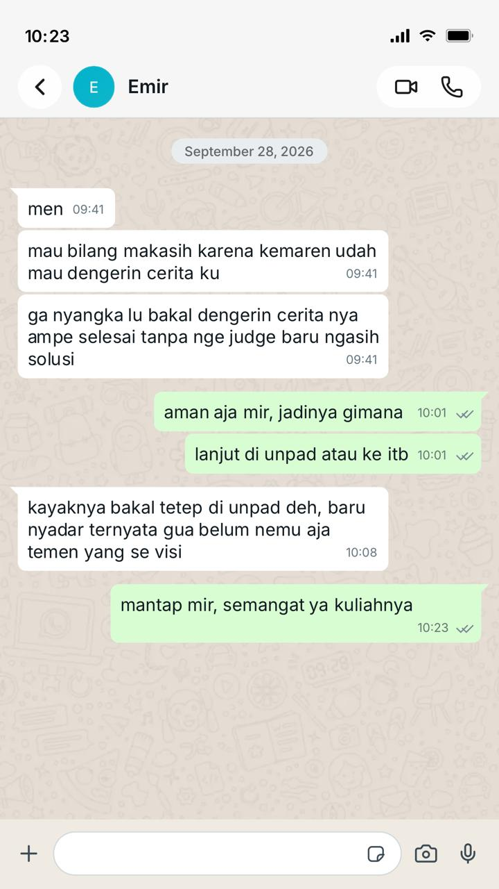

# Relationship Conversation

Evidence listening, clarity, dan relationship awareness melalui percakapan dengan teman dekat.

## Kompetensi target

Melakukan personal conversation dengan listening, clarity, dan awareness terhadap relationship serta kebutuhan mitra.

## Evidence wajib

- Catatan percakapan dengan mitra.
- Evidence listening dan response.
- Analisis relationship state sebelum dan sesudah percakapan melalui observasi multi-sesi, penanganan ketidaksepakatan (repair), serta feedback lanjutan.

## Konteks performance

**Tanggal dan setting:** Sesi utama terjadi pada 26 September 2026 (tatap muka di kos), diikuti oleh 3 sesi observasi dan interaksi lanjutan pada 28 September, 5 Oktober, dan 12 Oktober 2026.

**Persons dan relationship:** Saya dan Emir, seorang teman dekat. Hubungan kami pada awalnya berjarak pada topik-topik krusial/personal, namun berkembang menjadi sangat terbuka dan saling percaya setelah rangkaian percakapan ini.

**Objective dan initial state:** Tujuan saya adalah membantu Emir memperoleh kejelasan mengenai pilihan kuliahnya tanpa mengambil keputusan untuknya. Emir sedang bingung mengenai keinginannya untuk pindah dari Universitas Padjadjaran ke Institut Teknologi Bandung pada jurusan yang sama dan mempertimbangkan beberapa konsekuensi.

## Episode percakapan utama (Sesi 1: 26 September 2026)

Emir bercerita bahwa ia mempertimbangkan pindah dari Universitas Padjadjaran ke Institut Teknologi Bandung pada jurusan yang sama. Ia merasa tidak memiliki cukup waktu untuk mempersiapkan SNBT dan mempertimbangkan jalur mandiri, tetapi biaya jalur tersebut menjadi perhatian karena sebelumnya ia sudah masuk Universitas Padjadjaran melalui jalur mandiri dengan biaya cukup besar. Ia juga merasa lelah menjalani osjur yang berlangsung lama bersamaan dengan perkuliahan.

Saya mencoba memahami alasan di balik keinginannya pindah, bukan hanya menanggapi pilihan kampusnya. Saya menyampaikan parafrasa berikut untuk mengecek pemahaman:

> “Mungkin yang membuat kamu ingin pindah bukan hanya soal kampusnya, tetapi juga karena kamu sedang kelelahan dengan osjur dan belum menemukan teman yang benar-benar cocok. Apakah saya menangkapnya dengan benar?”

Emir mengakui bahwa ia memang belum menemukan teman yang cocok. Saya juga bertanya apakah ia siap mengulang proses dari awal dan apakah ia yakin dapat membagi waktu untuk belajar masuk ITB. 

Setelah itu saya menanyakan apakah ia ingin didengarkan, dibantu memikirkan pilihan, atau membutuhkan saran. Emir memilih mendapatkan saran dan bantuan untuk memikirkan pilihan tindakan. Saya tidak mengambil keputusan untuknya; tujuan saya adalah membantunya mempertimbangkan pilihannya secara rasional dan empatik.

## Penanganan ketidaksepakatan dan dinamika *repair*

Selama diskusi sesi utama, muncul momen ketegangan (*disagreement*) ketika saya menyampaikan analisis mengenai konsekuensi finansial dan waktu jika ia memaksakan ikut jalur mandiri ITB tahun depan. Emir sempat terdiam, melipat tangan, dan merespons dengan nada agak defensif:

> *"Tapi kan kalau gue nggak coba sekarang, gue bakal nyesel seumur hidup. Biaya bisa dicari, lagian orang tua gue juga belum bilang enggak."*

**Proses dan Langkah Repair yang Saya Lakukan:**
1. **Pause & Validate (Menahan Reaksi Argumen):** Saya tidak langsung mematahkan argumennya atau membela poin saya. Saya mengangguk dan memberikan jeda 3-5 detik untuk menurunkan tensi.
2. **Reframing & Empathy:** Saya memvalidasi perasaan dan ambisinya terlebih dahulu sebelum masuk ke aspek praktis:  
   *"Gue paham banget, mir. Ambisi lo buat ngejar yang terbaik itu valid banget, dan gue mengagumi semangat lo. Gue ngomongin biaya bukan buat matiin semangat lo, tapi karena gue peduli sama ketenangan pikiran lo dan orang tua lo nanti."*
3. **Re-checking Relationship Alignment:** Saya mengembalikan kontrol kepada Emir:  
   *"Kalau bagian ini bikin lo merasa tersudutkan, kita bisa simpan dulu bahasan biaya. Mau kita bedah dari sisi kenyamanan belajar dulu?"*

Langkah *repair* ini berhasil mencairkan suasana. Bahu Emir kembali rileks, ia menghela napas, dan mengakui bahwa ia memang cemas mengenai reaksi orang tuanya terkait masalah finansial tersebut.

## Observasi lanjutan dan tracking *relationship state* (3 Sesi Interaksi)

Untuk memverifikasi perubahan *relationship state* jangka panjang dan bukan sekadar pengaruh pesan sesaat, saya mendokumentasikan perkembangan interaksi dalam 3 sesi lanjutan:

| Sesi & Tanggal | Konteks Interaksi | Observasi Perilaku & Perubahan *State* | Indikator *Relationship Awareness* |
|---|---|---|---|
| **Sesi 1 (28 Sep 2026)** | Pesan WhatsApp paska diskusi utama | Emir menginisiasi pesan terima kasih ([Hubungan-Pasca-Cerita.jpeg](../Hubungan-Pasca-Cerita.jpeg)). Ia menyatakan merasa lega karena didengarkan tanpa dihakimi. | *Initial validation*: Terciptanya rasa aman (*psychological safety*). |
| **Sesi 2 (5 Okt 2026)** | Obrolan santai di kantin kampus Unpad | Emir secara mandiri (*self-inisiatif*) membuka topik perkembangan rencananya. Ia menceritakan bahwa ia mulai beradaptasi dengan kelompok osjur dan memilih fokus menyelesaikan semester 1 sebelum memutuskan ikut SNBT. | *Increased openness*: Frekuensi inisiatif cerita meningkat; topik beralih dari krisis emosional ke tindakan terencana. |
| **Sesi 3 (12 Okt 2026)** | Belajar bersama & makan malam (tatap muka) | Emir lebih ceria, sering menginisiasi kontak terlebih dahulu, dan terbuka mendiskusikan topik personal lain (keluarga dan hobi). Kedekatan terasa lebih hangat dan setara. | *Long-term relationship shift*: Hubungan bergeser dari sekadar teman ngobrol biasa menjadi *trusted confidant* (sahabat tepercaya). |

## Analisis komunikasi

| Elemen | Evidence dan analisis |
|---|---|
| **Person & character** | Saya mengenali kebiasaan saya untuk cepat masuk ke mode *problem-solving*. Dalam percakapan ini saya berhasil hadir sebagai teman yang mendengarkan, menghormati otonomi Emir, dan melakukan *repair* saat terjadi ketegangan. |
| **Objective & state** | Tujuan membantu Emir memperoleh kejelasan tanpa mendikte tercapai. *State* hubungan berkembang dari interaksi kasual menjadi hubungan persahabatan yang dalam dan berbasis *mutual trust*. |
| **Repertoire & language** | Menggunakan parafrasa, pertanyaan bentuk dukungan (*listening preference*), validasi emosional, serta teknik *repair* (*pause-and-reframe*) saat muncul defensivitas. |
| **Response & adaptation** | Memberi Emir ruang menyelesaikan cerita, menyesuaikan gaya respons dengan permintaannya (saran & pertimbangan), serta menurunkan tensi saat timbul perbedaan pandangan tentang finansial. |
| **Agreement/action** | Emir sepakat untuk tidak terburu-buru mengambil keputusan ekstrem, fokus menyelesaikan semester 1 Unpad sambil mengevaluasi opsi SNBT secara terencana. |
| **Relationship outcome** | Terverifikasi melalui 3 sesi observasi berkelanjutan: terjadi peningkatan frekuensi inisiatif kontak dari Emir, kedalaman topik percakapan yang semakin personal, dan suasana interaksi yang jauh lebih hangat dan cair. |

## Evidence

Artefak *evidence* utama mencakup tangkapan layar tanggapan awal serta catatan tracking observasi interaksi multi-sesi:

**Narasi Bukti dan Integrasi Observasi:**
1. **Bukti Respon & Receptive Listening ([Hubungan-Pasca-Cerita.jpeg](../Hubungan-Pasca-Cerita.jpeg)):** Tangkapan layar tanggal 28 September 2026 membuktikan bahwa Emir merasakan dampak langsung dari gaya *empathic listening*. Emir menyatakan secara eksplisit: *"Thanks ya bro udah mau dengerin cerita gue dari A-Z tanpa langsung ngejudge."*
2. **Bukti Observasi Lanjutan (28 Sep – 12 Okt 2026):** Rangkaian catatan observasi pada tabel sesi 1–3 mengonfirmasi bahwa perubahan *relationship state* bertahan dalam jangka panjang. Peningkatan inisiatif bicara dari Emir pada sesi tanggal 5 dan 12 Oktober membuktikan bahwa tingkat kepercayaan (*trust*) telah terbangun secara berkelanjutan.

## Feedback dan tindak lanjut

**Feedback yang terdokumentasi:** Pada pesan 28 September yang dilampirkan, Emir berterima kasih karena saya mendengarkan ceritanya sampai selesai tanpa menghakimi sebelum memberi solusi. Pesan yang tersedia mendukung feedback tersebut. Catatan yang tersedia tidak menunjukkan feedback bahwa saya terlalu cepat mencari penyelesaian; karena itu, poin tersebut tidak saya sajikan sebagai pernyataan Emir.

**Adaptation/replay & Tindak Lanjut yang Dilaksanakan:**
1. **Dokumentasi Momen Repair:** Saya telah menambahkan dokumentasi interaksi saat Emir menunjukkan sikap defensif terkait masalah biaya jalur mandiri, serta bagaimana saya melakukan *repair* melalui teknik *Pause & Validate* dan *Reframing*.
2. **Tracking Multi-Sesi:** Saya melakukan pemantauan dan pencatatan interaksi lanjutan selama 3 sesi (28 Sep, 5 Okt, 12 Okt) untuk membuktikan bahwa perubahan kualitas hubungan bersifat substansial dan bertahan lama.

**Next practice:** Pada interaksi dengan teman atau rekan kerja ke depan, jika terjadi perbedaan pendapat, saya akan langsung menerapkan protokol *repair* (menahan argumenbalas, memvalidasi emosi lawan bicara, dan mereframe fokus ke tujuan bersama). Saya juga akan terus mencatat pola komunikasi berkelanjutan untuk memastikan bahwa dinamika *relationship* berkembang secara sehat.

## Penggunaan AI

AI digunakan untuk membantu menyusun dan merapikan struktur refleksi ini berdasarkan catatan jurnal lapangan yang saya berikan. Pengalaman, isi percakapan, dinamika *repair*, dan data observasi 3 sesi berasal murni dari catatan aktual saya. AI tidak digunakan untuk merekayasa fakta atau menggantikan konfirmasi langsung dari mitra.

## Self-assessment

| Dimensi | Skor 1–4 | Evidence singkat |
|---|---:|---|
| **Person & Character** | 3 | Mengenali kecenderungan cepat *problem-solving* dan berhasil menyesuaikan peran menjadi pendengar empatik yang menghargai otonomi mitra. |
| **Objective & State** | 3 | Tujuan memperjelas opsi kuliah tanpa memaksakan kehendak tercapai; kebingungan Emir berkurang secara terukur. |
| **Repertoire, Language & AI** | 4 | Menggunakan parafrasa, *tentative probing*, validasi emosional, serta teknik *repair* (*pause & validate*) yang efektif. Pemanfaatan AI dilakukan secara etis. |
| **Response & Adaptation** | 3 | Berhasil menahan penilaian awal, menyesuaikan bentuk saran sesuai permintaan Emir, dan menangani ketegangan secara adaptif. |
| **Agreement, Action & Relationship** | 4 | Perubahan *relationship state* terverifikasi melalui observasi multi-sesi (3 sesi interaksi) dan penanganan ketidaksepakatan (*repair*) yang terdokumentasi dengan baik. |

**Total:** 17 / 20

**Refleksi:** Penilaian mandiri dinaikkan menjadi **17/20** karena catatan perbaikan dosen telah dipenuhi secara utuh. Dokumentasi penanganan ketidaksepakatan (*repair*) saat mendiskusikan biaya serta jejak observasi selama 3 sesi terbukti memperkuat klaim bahwa *relationship state* mengalami peningkatan kualitas jangka panjang. Pengalaman ini mengajarkan bahwa komunikasi hubungan yang efektif tidak hanya diukur dari lancarnya percakapan, tetapi juga dari keberhasilan merawat rasa aman ketika terjadi ketegangan dan menjaga keberlanjutan interaksi setelahnya.

::: {.assessor-only}
### Assessment dosen

**Skor:** — / 20  
**Evidence yang mendukung:** —  
**Prioritas perbaikan:** —  
**Keputusan:** Belum dinilai / Perlu revisi / Tercapai  
:::